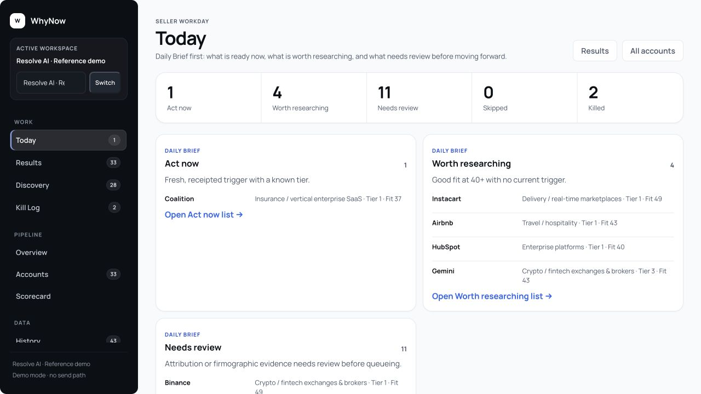
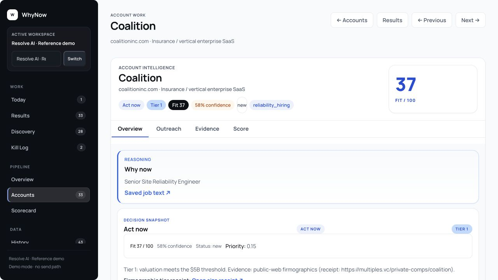
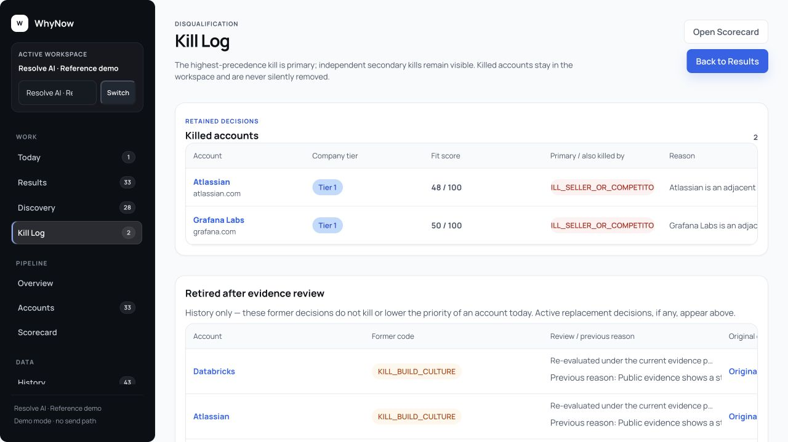
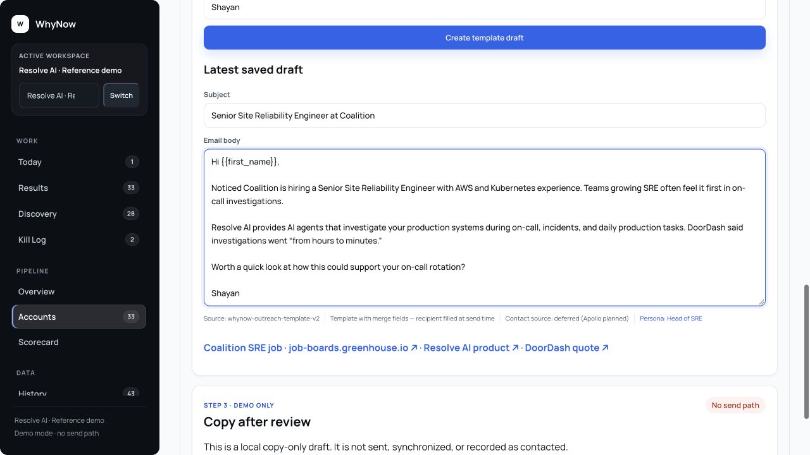

# WhyNow

**A prospecting engine that finds who to contact, why now, with a source for every claim.**

WhyNow turns an approved seller profile into a research queue: collect public buying signals, rule out unsuitable accounts, rank the remaining companies, and prepare an email a human can check and copy. It runs locally and keeps each seller's research separate.

## Features

- **Any-company AI research with human approval.** Start with a company name. Saved first-party pages support three focused research steps: seller facts, customer/competitor review, and ideal-customer targeting. Facts, receipts, warnings and suggested domains are editable; only a human approves a profile.
- **Public signal collectors.** Hiring from Greenhouse, Lever and Ashby; operational pain, dated news, engineering evidence and executive changes. Optional sources report failures rather than supplying made-up evidence.
- **Scoring and tiering.** A configurable six-signal scorecard explains fit and confidence. Company size/value determines a separate tier. Uncollected signals remain unknown with low confidence.
- **Evidence-backed kill rules.** Existing customers, competitors, unsuitable size and supported internal-build exclusions are retained in the Kill Log with a reason and receipt.
- **Today queue.** Act now requires a relevant, dated trigger inside its window and a known tier. Worth researching separates good-fit companies without a current trigger; Needs review holds unresolved company identity or evidence issues.
- **Fact-checked drafts.** Deterministic templates and optional AI drafts share grounding, attribution, freshness and readability checks. Demo greetings use `{{first_name}}`; no recipient is invented. Copy only—there is no send path.
- **Cost controls.** Provider switches, persistent usage accounting, per-run query ceilings and dollar caps guard external calls. A key alone does not enable paid work.

## How it works

1. **Choose the seller.** Confirm the official company and collect permitted public pages into its isolated workspace.
2. **Review the ICP.** AI proposes seller facts, customer/competitor candidates, segments, personas, size rules and messaging. Receipts and blocking warnings sit beside the fields. The owner corrects and approves the saved revision.
3. **Find and verify prospects.** Discovery searches approved roles and technologies, verifies the ATS posting and employer, then checks segments, customer/competitor exclusions and company size. Rejected page noise is retained separately.
4. **Collect and qualify.** Background jobs collect evidence, update fit and tier, apply kill rules and deduplicate triggers. Hiring relevance uses the title and department; freshness uses the original publication date, never a later edit.
5. **Work Today.** Open a ranked account, inspect its scorecard and sources, and choose new, working or skipped. Skipping requires a reason.
6. **Review and copy a draft.** Use the template or a separately enabled AI draft. Specific facts and numbers must be supported; statistics name their customer source. Nothing is sent or recorded as sent.

## Screenshots

Captured from the local saved-evidence demo on November 12, 2026. The queue changes as evidence expires; these are real screens, not mockups.

### Today / Daily Brief



### Account detail



### Kill Log



### Email draft



## Tech stack

- **Node.js 22**, CommonJS domain modules and the built-in HTTP/HTTPS servers.
- **Server-rendered HTML, CSS and small browser scripts**, with local Manrope fonts and no frontend build step.
- **Atomic JSON persistence:** flush, rename and last-good backup. `STATE_DIR` selects storage; workspaces isolate seller data. Long work runs as background jobs.
- **Guarded public collection:** DNS/private-address checks, robots.txt, identifying User-Agent, pacing, bounded responses and caching. Serper and OpenAI are optional HTTP integrations.
- **Vitest** with recorded public responses and synthetic cases. Tests never call live providers. GitHub Actions runs tests, dependency checks and secret scanning.

## Run locally

Use Node.js 22 and npm. From this folder:

```bash
npm ci
cp .env.example .env
npm test
OPENAI_ENABLED=false OPENAI_MONTHLY_LIMIT_USD=0 SERPER_ENABLED=false SCHEDULER_ENABLED=false GDELT_ENABLED=false EDGAR_ENABLED=false GITHUB_ENABLED=false npm start
```

Open **[http://127.0.0.1:3000/today](http://127.0.0.1:3000/today)**. Keep the terminal open throughout the interview; `Ctrl+C` stops the server. The default host is localhost and the default port is 3000. Set `PORT` for another port or `STATE_DIR` for another local state directory.

For a new checkout, open Overview and choose **Load Resolve reference demo** to load its frozen seller configuration. This does not approve any real profile or fetch evidence. The screenshots use existing local research; private runtime state and saved recipient data are not distributed in Git. Add accounts manually to explore scoring without calling providers.

Optional provider configuration belongs only in the ignored `.env`. Public collection requires `CRAWLER_CONTACT_EMAIL` and explicit enable switches/caps; research and model drafts also require an explicitly authorized OpenAI budget. Keep provider switches off for a saved-evidence interview walkthrough. Never commit credentials or manually entered contacts.

Useful routes: `/today`, `/accounts`, `/kill-log`, `/workspaces`, `/onboarding/profile`, `/discovery`, `/scorecard`. `/health` reports server health.

## Known limitations and next steps

- **New-seller discovery still needs improvement.** The latest Vercel run did not yield a qualified Act now buyer. Documentation, job boards and adjacent vendors can resemble companies; strict gates retain those rejections and put ambiguous employers in review. Technographic discovery is the next direction, not an implemented capability.
- **Research needs human correction.** Customer/competitor extraction can miss names or domains, and segments, personas and size floors need review. Receipt coverage alone does not prove business accuracy.
- **Fresh evidence expires.** Coalition remains current in the saved Resolve demo; Okta's job was originally published in June and no longer qualifies as why-now. Historical drafts remain available with the current trigger gate visible.
- **Some public sources block collection.** SEC endpoints have returned 403; GDELT has returned rate limits. Failures remain visible and do not block independent sources. Links may redirect or close, so saved ATS text is available when captured.
- **Local portfolio demo, one process.** Production authentication, shared database operations, backup infrastructure and deployment are deferred. The JSON backup can lag one successful save.
- **Apollo contacts are future work.** No contact lookup or sending is implemented. Any future integration needs an off-by-default switch, account fit/kill gates and a strict credit cap.

See [demo preparation](docs/DEMO-PREP-GUIDE.md), [build checklist](docs/BUILD-CHECKLIST.md), [traceability](docs/TRACEABILITY.md) and [final verification](docs/FINAL-DEMO-CLOSEOUT.md).
